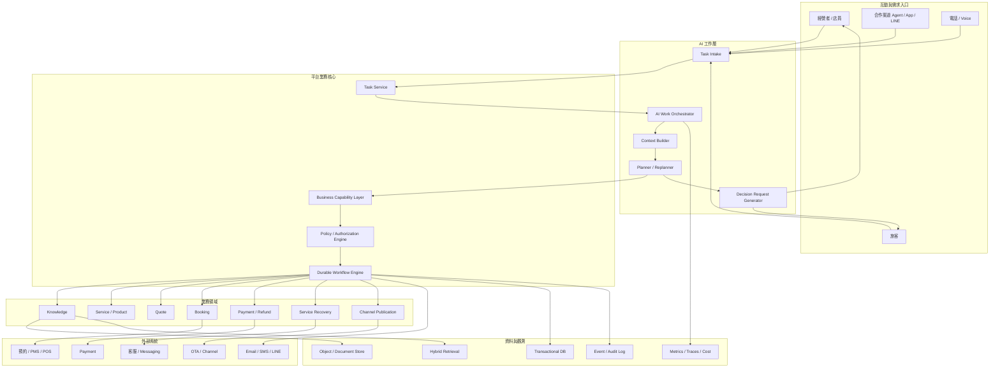
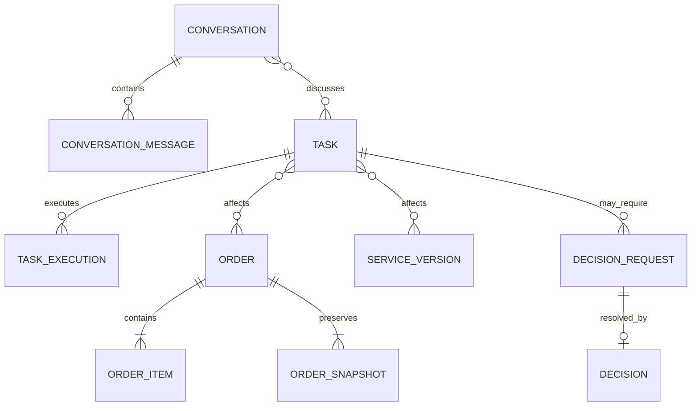
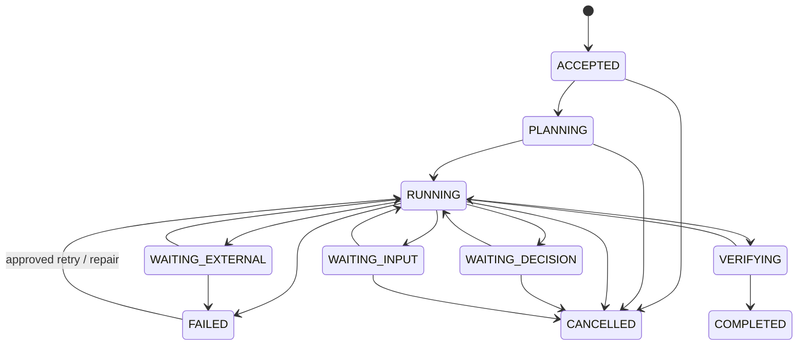
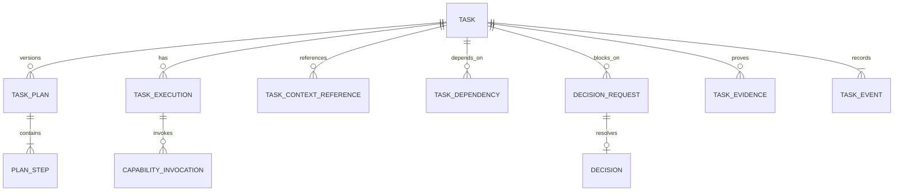

# 旅行平台專案完整 SA／SD／資料模型／耐久工作流程／API／UX 規劃（重建版）

> 來源轉存：本檔為既有研究報告的主文，原報告中的交付與測試描述代表當時說法。2026-11-22 接手時的實際檔案與驗證狀態，請以 [原檔匯入紀錄](../provenance/README.md) 及 [驗證說明](../verification/README.md) 為準。歷史 sandbox 路徑不代表 repository 中已有對應工程檔案。來源引用已由原報告所附網址轉為一般連結。


## 重建說明

本文件標示為**「重建版」**。原因是先前 Deep Research 產生的原始報告目前無法由這個一般對話直接讀取；因此我不把無法存取的內容冒充成原始報告，而是以目前對話中已確認的產品方向、可搜尋到的既有「旅行平台專案」研究文件，以及最新官方技術文件重新整合。

目前可取得的舊研究已明確指出：平台真正應累積的資產不是「一個比較會聊天的旅遊 AI」，而是**商家持續維護、具來源、有效期限、用途權限，而且能與交易結果關聯的私有商業知識與交易能力**；商家端可以成為資料的 write path，渠道與旅客端則是 read/distribution path。 （原報告引用文件：以「商家私有知識網路」為核心的國內旅遊平台：商業模式深度研究；未以此推定本次取得）

另一份既有研究則進一步把這件事定義成 **Private Travel Commerce Graph**：資料不只要回答「內容是什麼」，還必須回答來源、是否仍有效、哪些渠道可使用、是否可執行交易，以及最後有沒有形成商業結果。 （原報告引用文件：台灣國內旅遊平台長期競爭優勢：多路徑商業切入模式深度研究；未以此推定本次取得）

本次架構在這個基礎上再往前一步：**產品的第一級核心不再是 Knowledge Graph，而是「被 AI 接受並負責完成的工作 Task」；Knowledge、Transaction、Channel、Workflow 都成為完成工作的能力。**

這與目前 Agent 工程實務相符。Anthropic 將可預測的 workflow 與模型自行決定下一步的 agent 區分，並建議依可預測性與彈性需求混合使用，而不是所有事情都交給自主 Agent。 [Building Effective AI Agents \ Anthropic](https://www.anthropic.com/engineering/building-effective-agents?slug=helpful-honest-harmless-ai&utm_source=chatgpt.com) OpenAI 的工具呼叫架構同樣把「模型提出 tool call」與「應用程式真正執行工具」分開；在 Realtime 語音場景中，官方亦明確建議把私有工具執行、授權檢查與 business rules 留在伺服器端。 [Function calling | OpenAI API](https://developers.openai.com/api/docs/guides/function-calling?utm_source=chatgpt.com)

以下先交付你指定的第一階段內容：**Executive summary、完整章節目錄，以及系統目標、核心概念、Task 定義和資料模型概要。**

## Executive summary

本專案的核心產品定義應改成：

> **一個代表商家接受工作、理解目標、使用商家既有系統完成工作，並在必要時才向人要求新決策的 AI 營運系統；同一批經授權的供應、知識與交易能力，再以 API 或 Agent 能力提供給旅客端及外部渠道。**

因此系統不應以「商家後台有哪些頁面」作為主架構，而應以以下責任鏈作為主架構：

```text
人提出目標／客戶產生需求
        ↓
建立 Task
        ↓
AI 理解目標、上下文與完成條件
        ↓
形成可調整 Plan
        ↓
呼叫受控 Business Capabilities
        ↓
耐久流程負責等待、重試、事件、恢復
        ↓
Connector 操作真實外部系統
        ↓
讀回並驗證正式結果
        ↓
完成 Task／提出真正需要人的 Decision Request
```

其中最重要的設計原則有七項。

**第一，Task 是第一級物件。**聊天、語音、訂單、退款、素材與渠道發布都不是系統的最高層抽象；最高層是「系統承諾完成什麼工作」。

**第二，Conversation、Task、Order 必須分離。**一段對話可以產生數個工作；一個工作可能跨越數次對話；一張訂單則可能經歷接單、付款、改期、退款與客訴多個工作。

**第三，AI 負責理解與規劃，但不能自己創造交易事實。**AI 可以決定「下一步應查庫存」或「應建立退款」，但正式價格、名額、付款、退款、發布成功與否，都必須來自正式系統。OpenAI 官方工具架構本身也是由模型提出工具呼叫，再由應用程式執行並回傳結果。 [Function calling | OpenAI API](https://developers.openai.com/api/docs/guides/function-calling?utm_source=chatgpt.com)

**第四，耐久工作流程是核心基礎設施。**工作可能等待數分鐘、數天甚至數週，期間不應持續佔用模型，也不能因為瀏覽器關閉或 Worker 重啟而失去進度。Temporal 的 Workflow Execution 以事件歷史重建狀態，可等待 Signal、Timer，並在 Worker failure 後繼續執行，因此適合承載這類長生命週期工作。 [Understanding Temporal | Temporal Documentation](https://docs.temporal.io/evaluate/understanding-temporal?utm_source=chatgpt.com)

**第五，外部副作用必須額外做冪等與結果查核。**Workflow durable 不代表第三方 API 一定 exactly-once；退款、付款、訂位、發布等必須使用固定 business operation ID、idempotency key 或「先查結果再重試」。Temporal 官方也明確指出 Activity 可能實際重跑，因此 side-effecting operation 應設計冪等性。 [Agent memory and state | Temporal Documentation](https://docs.temporal.io/ai/featured/memory-state-stripe?utm_source=chatgpt.com)

**第六，商家知識與交易資料不是單純 RAG。**過往研究已確立：critical facts 應存在 structured source of truth，並保存來源、有效期、適用範圍與渠道權限；RAG 主要負責找到相關非結構化內容。 （原報告引用文件：以「商家私有知識網路」為核心的國內旅遊平台：商業模式深度研究；未以此推定本次取得）

**第七，UX 的核心不是 dashboard，而是 exception／decision surface。**正常工作完成後只回報結果；只有需要新的商業承諾、缺少商家獨有知識、授權失效或高風險操作時，才找對應的人。這也符合 OWASP 對 Agent 高風險操作的建議：模型可以提出行動，但執行層仍應獨立驗證 actor、resource、parameters、授權與必要 approval。 [AI Agent Security - OWASP Cheat Sheet Series](https://cheatsheetseries.owasp.org/cheatsheets/AI_Agent_Security_Cheat_Sheet.html?utm_source=chatgpt.com)

最終高階系統可先理解為：



這裡刻意讓 **AI Orchestrator 不直接連 Stripe、OTA 或預約系統**；它只能透過受控 Business Capability Layer 觸發正式操作。

這也是整份 SA／SD 後續章節最重要的技術原則。

## 章節目錄

完整版本預計依以下結構展開。本次訊息完成前三個主體章節，後續章節將延續同一份規格，不另外產生私有附件。

| 章節 | 主要內容 |
|---|---|
| **系統目標與責任範圍** | 商家端、旅客／渠道端、平台端；系統內與系統外責任；成功與失敗定義 |
| **核心領域模型與工作物件** | Task、Conversation、Order、Decision、Plan、Execution、Evidence；Task 七項必要資訊 |
| **資料模型與 Source of Truth** | 商家營運設定、服務知識、商品條件、交易、工作、經營觀察及其關聯 |
| **高階 SA 與元件邊界** | Entry、Agent Orchestrator、Capability Layer、Workflow、Connector、Data、Audit |
| **耐久工作流程與狀態機** | Task lifecycle、語音接單、退款、渠道發布；Signal、Timer、Retry、Compensation |
| **SD 與 API 規格** | REST resource、command/query、webhook、idempotency、connector contract、error model |
| **權限、安全與稽核** | tenant isolation、merchant authorization、customer consent、tool permission、PII、prompt injection |
| **UX 與交付路線** | 經營者首頁、Decision Card、Work detail、mobile flow、MVP、技術選型、測試、KPI、風險 |

## 系統目標與責任範圍

### 產品真正要完成的事

平台不是要把所有商家軟體重新做一次，也不是要建立一個「老闆可以看到所有 AI 動作」的管理後台。

系統真正要完成三件事：

**商家端：把日常營運工作接走。**

包含客戶詢問、接單、查價查位、付款接續、售後、退款、客訴、服務內容改善、素材整理與多渠道發布。

商家仍保有原有預約、支付、POS、CRM、OTA 或其他營運系統；平台的工作是把它們變成 AI 可以安全使用的 business capabilities，而非強迫商家搬到另一套全新 ERP。

**旅客／渠道端：把商家的可用能力變成可查詢、可比較、可交易的供給。**

過去研究已確立，合作渠道未必要使用平台自己的 LLM；平台可以提供 Managed Concierge，也可以提供 Knowledge／Commerce API，讓銀行、會員 App、旅行社或其他 Agent 用自己的模型。 （原報告引用文件：以「商家私有知識網路」為核心的國內旅遊平台：商業模式深度研究；未以此推定本次取得）  （原報告引用文件：台灣國內旅遊平台長期競爭優勢：多路徑商業切入模式深度研究；未以此推定本次取得）

因此：

```text
平台核心能力 ≠ UI
平台核心能力 ≠ 某一個 LLM
平台核心能力 =
    permissioned knowledge
  + operational capabilities
  + durable tasks
  + transaction evidence
```

**平台端：保證工作可以安全、可追蹤地完成。**

也就是管理 tenant、identity、authorization、Task、Workflow、Connector、Audit、Observability、Cost attribution，以及多商家與多渠道之間的資料隔離。

### 三個責任平面

整體可分成 Merchant Plane、Consumer／Channel Plane、Platform Control Plane。

| 平面 | 代表誰 | 可以做什麼 | 不可以做什麼 |
|---|---|---|---|
| **Merchant Plane** | 特定商家 | 使用店內知識、訂單、服務規則及授權工具完成商家工作 | 自動取得其他商家 internal data |
| **Consumer / Channel Plane** | 旅客或合作渠道 | 查詢被授權對外使用的商品、適配條件、availability、price、booking action | 直接取得商家成本、內部 SOP、其他顧客資料 |
| **Platform Control Plane** | 平台 | identity、policy、workflow、audit、routing、billing、connector health | 以平台營運便利為理由任意擴大商家或旅客資料用途 |

過往研究已經提出類似分離：Merchant Knowledge Plane、Consumer Data Plane、Analytics Plane，並明確建議不要把商家知識與旅客 PII 混成同一個 RAG。 （原報告引用文件：以「商家私有知識網路」為核心的國內旅遊平台：商業模式深度研究；未以此推定本次取得）

本次 SA 將這個概念再收斂成**資料權限與執行權限同時隔離**。

### 系統責任與外部系統責任

一個常見的架構錯誤，是平台接到第三方系統後，就把對方的資料複製進自己資料庫，再把自己當唯一真相來源。

這裡不這樣做。

| 資料／行為 | 建議 Source of Truth |
|---|---|
| Task 狀態、Plan、Decision、Execution | 本平台 |
| 商家使用者、平台角色與授權範圍 | 本平台 IAM／Policy |
| Merchant verified knowledge | 本平台 Knowledge Store |
| Availability | 原 booking／inventory system，或明確指定主系統 |
| 正式 Price | 商品／報價服務或原 pricing system |
| Payment state | Payment Service Provider |
| Refund state | 原 payment／order domain |
| 外部渠道商品狀態 | 該渠道讀回結果 |
| 成交時承諾 | 本平台 immutable Order Snapshot |
| 對話 transcript | 通訊／語音來源＋平台必要索引 |
| Analytics derivative | 本平台，但不得取代原交易事實 |

這意味著：

> **平台可以保存 projection、cache 與 snapshot，但必須知道哪個欄位真正 authoritative。**

### 「完成」必須有證據

AI 不得只因為工具回傳 `200 OK`，就向商家說工作完成。

每一類工作都需要 `completion_evidence`。

例如：

| Task | 完成證據 |
|---|---|
| Booking | external booking ID＋confirmed state＋成交內容 snapshot |
| Refund | PSP／order system 的 refund ID＋final state |
| Publication | channel listing ID＋published version＋read-back verification |
| Knowledge update | approved fact version＋effective timestamp |
| Notification | provider delivery result；若只要求「送出」則可依 accepted state |
| Customer recovery | compensation action complete；但 customer dispute 是否 resolved 是另一欄位 |

Temporal 的 durable execution 可以保存 workflow progress，但官方文件也強調 Activity 是可能重試的，因此 durable workflow 本身不能當作第三方 operation 已完成的證明。 [Agent memory and state | Temporal Documentation](https://docs.temporal.io/ai/featured/memory-state-stripe?utm_source=chatgpt.com)

這會成為後續 API 與 database schema 的硬規則：

```text
TASK_DONE
≠
MODEL_SAYS_DONE

TASK_DONE
=
completion_condition satisfied
AND
required evidence recorded
```

## 核心領域模型與 Task 定義

### 為什麼 Task 必須成為第一級 Domain Object

過去系統很容易從畫面出發：

```text
訂單頁
退款頁
素材頁
渠道頁
客服頁
```

結果每個頁面都產生一組「請人按按鈕」的流程。

新的設計從責任出發：

> **有人交付一個目標給系統，系統接受這個責任，直到完成、取消、明確失敗，或需要新的外部決策。**

例如：

```text
Task A
「替王先生完成 12/5 下午茶體驗預訂」

Task B
「依既有退款政策處理 Order #12345」

Task C
「把新的 60 分鐘體驗發布到官網與合作旅宿」

Task D
「研究為什麼近期大量旅客詢問短時長版本，
並在有足夠證據時形成服務調整提案」
```

Task C 可能包含：

```text
查現有服務
→ 找差異
→ 查資源限制
→ 收缺少素材
→ 整理 proposal
→ 取得商家決策
→ 建立 service version
→ 發布三個 channel
→ 等待 channel review
→ 驗證結果
```

但商家看見的仍是一件工作。

### Task 七項必要資訊

這七項不是單純 database columns，而是所有 AI 工作在開始執行前都必須具備的 semantic contract。

| 必要資訊 | Schema 建議 | 意義 |
|---|---|---|
| **代表誰執行** | `principal` | tenant、merchant、channel、customer，以及 acting role |
| **要完成什麼** | `objective` + `completion_conditions` | 目標與機器可判斷完成條件 |
| **依據什麼** | `context_refs` + `evidence_refs` | 哪些訂單、服務版本、政策、知識、對話或文件 |
| **可自行決定什麼** | `authority_scope` | 哪些價格、補償、發布、通知或工具操作已被預先授權 |
| **目前計畫與依賴** | `plan` + `dependencies` | 步驟、條件、並行、blocking state |
| **卡住找誰** | `escalation_policy` | customer、merchant owner、staff、ops、support、engineering |
| **怎麼證明完成** | `completion_evidence_spec` | 外部 ID、讀回狀態、transaction snapshot、approval record 等 |

建議最低資料結構：

```json
{
  "task_id": "tsk_01J...",
  "tenant_id": "mer_123",
  "type": "CHANNEL_SERVICE_PUBLICATION",
  "principal": {
    "merchant_id": "mer_123",
    "acting_role": "MERCHANT_AGENT"
  },

  "objective": {
    "summary": "將 60 分鐘茶體驗發布至官網與 Partner A",
    "target_service_version": "sv_29"
  },

  "completion_conditions": [
    "WEB.version == sv_29",
    "PARTNER_A.version == sv_29",
    "published_content passes validation"
  ],

  "context_refs": [
    "service:svc_88",
    "service_version:sv_29",
    "decision:dec_41"
  ],

  "authority_scope": {
    "allowed_capabilities": [
      "publish_service",
      "read_channel_status"
    ],
    "max_financial_impact": 0
  },

  "plan_version": 4,

  "escalation_policy_id": "ep_merchant_publication_v2",

  "completion_evidence_spec": [
    "channel_listing_id",
    "readback_version",
    "verified_at"
  ]
}
```

### Task 不等於固定 Workflow

Task 是 business responsibility。

Workflow 是這次執行 Task 的 orchestration implementation。

這兩者要分開。

例如：

```text
Task:
「完成退款」

Workflow v1:
check_order
→ check_policy
→ create_refund
→ wait_webhook
→ verify

Workflow v2:
check_order
→ resolve_original_payment_route
→ create_refund
→ reconcile
→ notify_customer
```

Task ID 不必因為 workflow implementation 升版而改變。

這樣才能做到：

```text
business history 穩定
implementation 可以演進
```

### Conversation、Task、Order 的關係

這是整個 schema 中非常重要的一組關係。



因此：

**Conversation 是 communication container。**

它回答：

> 誰在什麼時間說了什麼？

**Task 是 responsibility container。**

它回答：

> 系統目前承諾完成什麼？

**Order 是 commerce record。**

它回答：

> 哪一筆正式交易成立、成交條件是什麼？

以下情境可以說明為什麼三者不能合併。

旅客打電話：

> 想訂星期六下午。

同一個 Conversation 產生：

```text
Task 1：查詢並完成 booking
```

數天後旅客在 LINE 說：

> 小孩生病，想改時間。

這是第二個 Conversation，但產生：

```text
Task 2：修改同一張 Order
```

若當天又發生服務爭議：

```text
Task 3：處理同一張 Order 的 service recovery
```

所以：

```text
1 Order
≠
1 Task

1 Conversation
≠
1 Task
```

### Task lifecycle

第一版建議採用以下邏輯狀態，而不是把每個技術 Activity 都暴露成產品狀態。



其中 `WAITING_*` **不是錯誤狀態**。

例如：

```text
WAITING_EXTERNAL
渠道審核中
退款 PSP processing
等待 booking system callback

WAITING_INPUT
等客戶提供護照資料
等商家傳一張缺少照片

WAITING_DECISION
需要經營者決定是否接受新的補償
需要客戶確認新的價格
```

Temporal 的 Signals、Timers 與 durable event history 正適合實作這類「不用持續執行 CPU，但幾天後仍能從原進度繼續」的工作。 [Understanding Temporal | Temporal Documentation](https://docs.temporal.io/evaluate/understanding-temporal?utm_source=chatgpt.com)

### AI Planner 與 Workflow Engine 的分工

我建議採用：

> **Agentic Planning + Deterministic Execution**

AI Planner 可以做：

```text
理解 objective
挑選需要的 capabilities
決定資訊是否不足
建立 / 修改 plan
分析 exception
決定該問誰
整理 Decision Request
```

Execution Layer 負責：

```text
authorization
schema validation
price / inventory source
idempotency
transaction
retry
timeout
locking
audit
result verification
```

Anthropic 對 workflow 與 agent 的建議，也支持這種混合模式：固定、風險高、可預測部分適合 workflow；開放式、需要模型依上下文調整策略的任務，才適合讓 agent 自行選擇步驟。 [Building Effective AI Agents \ Anthropic](https://www.anthropic.com/engineering/building-effective-agents?slug=helpful-honest-harmless-ai&utm_source=chatgpt.com)

OWASP 則進一步要求高影響行為應將「decision」與「execution」分離，且執行端要獨立檢查授權、scope 與 approval，不能只相信 Agent context 裡的 `user_confirmed=true`。 [AI Agent Security - OWASP Cheat Sheet Series](https://cheatsheetseries.owasp.org/cheatsheets/AI_Agent_Security_Cheat_Sheet.html?utm_source=chatgpt.com)

所以：

```text
Agent:
「我認為符合退款政策，應退款 NT$1,200。」

≠

Refund executed.
```

正確流程是：

```text
Agent proposes:
refund(order_123, 1200)

        ↓

Capability Layer:
驗證 tenant
驗證 actor
驗證 order
驗證 refundable amount
驗證政策版本
驗證 authorization
取得 operation key

        ↓

Workflow:
執行 refund activity

        ↓

Connector:
Stripe / PSP / original merchant system

        ↓

Result verification:
refund_id
amount
state
external reference

        ↓

Task evidence
```

## 資料模型與 Source of Truth 概要

### 六個資料領域

既有研究已提出商家營運、服務知識、交易級資料和 outcome data 應分開管理，而不是全部丟進 document chunks。 （原報告引用文件：以「商家私有知識網路」為核心的國內旅遊平台：商業模式深度研究；未以此推定本次取得）  （原報告引用文件：台灣國內旅遊平台長期競爭優勢：多路徑商業切入模式深度研究；未以此推定本次取得）

本版 SA 建議正式劃成六個主要 data domains。

| Data domain | 代表物件 | 核心問題 |
|---|---|---|
| **Merchant Operations** | Merchant、Location、Role、Policy、Authority | 這家店如何營運？誰能決定什麼？ |
| **Service Knowledge** | Knowledge Fact、Source、Asset、Claim、Evidence | 關於服務，我們真正知道什麼？ |
| **Commerce Catalog** | Service、Version、Offer、Price Rule、Resource Constraint | 對外究竟承諾什麼、可以怎麼賣？ |
| **Transactions** | Quote、Order、Payment、Refund、Fulfillment | 正式交易現在是什麼狀態？ |
| **Work Management** | Task、Plan、Execution、Decision、Evidence | AI 現在負責完成什麼？ |
| **Observation & Learning** | Query、Event、Outcome、Insight、Experiment | 發生了什麼？哪些問題值得改善？ |

### Merchant Operations

最小資料集合：

```text
Merchant
Location
MerchantUser
Role
OperationalPolicy
AuthorityGrant
EscalationPolicy
ChannelAgreement
ConnectorAccount
```

其中 `AuthorityGrant` 很重要。

例如：

```json
{
  "subject": "merchant_agent",
  "capability": "refund_order",
  "constraints": {
    "max_amount": 1500,
    "must_match_existing_policy": true,
    "order_age_days_lte": 7
  }
}
```

這讓系統可以做到：

> 政策內退款自動完成，而不是每次叫老闆批准。

但超出 `NT$1,500`：

```text
Decision Request
→ 經營者
```

### Service Knowledge

Knowledge 不應只有：

```text
document_id
chunk
embedding
```

至少需要：

```text
KnowledgeFact
FactVersion
Source
Evidence
VisibilityScope
ChannelEntitlement
Validity
```

例如：

```json
{
  "fact_id": "fact_882",
  "merchant_id": "mer_123",
  "service_id": "svc_88",
  "predicate": "minimum_age",
  "value": {
    "age": 5,
    "condition": "hand_building"
  },
  "source": {
    "type": "merchant_confirmed",
    "source_id": "conv_991"
  },
  "valid_from": "2026-11-20",
  "valid_until": null,
  "visibility": "PRIVATE_DISTRIBUTABLE",
  "allowed_channels": [
    "merchant_own",
    "partner_a"
  ]
}
```

這延續舊研究中「public / merchant verified / private distributable / internal only / secret」的資料級別設計。 （原報告引用文件：以「商家私有知識網路」為核心的國內旅遊平台：商業模式深度研究；未以此推定本次取得）

### Commerce Catalog

Knowledge Fact 與 Product／Service 要分開。

例如：

```text
Knowledge:
「五歲可以做手捏。」

Commerce:
ServiceVersion 32
duration = 60 min
age_rule = 5+
price = 680
available_day = weekday
resource = instructor_group_A
```

新的服務版本至少需要：

```text
Service
ServiceVersion
ServiceComponent
ResourceRequirement
Offer
OfferVersion
PriceRule
AvailabilityRule
ChannelListing
```

核心原則：

> **文案不等於商品。**

對外承諾的服務內容必須版本化。

### Transaction

建議主要模型：

```text
Quote
QuoteItem
Order
OrderItem
OrderSnapshot
PaymentAttempt
Payment
Refund
Fulfillment
CustomerConsent
```

其中 `OrderSnapshot` 是必要物件。

因為商品可能後續修改：

```text
目前 ServiceVersion = 42
```

但三個月前成交的客戶仍必須依：

```text
OrderSnapshot.service_version = 37
```

處理客訴。

否則商家修改現在的文案，會污染過去成交時的事實。

### Work Management

這會是新版架構新增最重要的模型。

```text
Task
TaskContextReference
TaskDependency
TaskPlan
PlanStep
TaskExecution
CapabilityInvocation
DecisionRequest
Decision
TaskEvidence
TaskEvent
```

核心關聯：



這個 schema 的一個重要效果是：

**LLM context 不再等於 system memory。**

即使換模型或重新建立 prompt：

```text
Task objective
current state
latest plan
accepted decisions
tool results
completion evidence
```

仍然在平台資料層。

### Observation & Learning

這個 domain 不直接修改交易或商家政策。

它只產生：

```text
Observation
Metric
Pattern
InsightCandidate
Experiment
ExperimentResult
KnowledgeGap
```

例如：

```text
Observation:
21 個不同 session 中，
9 個使用者提到「時間太長」。

InsightCandidate:
可能存在 60–90 分鐘短版需求。

Confidence:
尚未證明「推出短版會提升成交」。

Suggested Task:
與 merchant 討論是否有可履約的短版服務。
```

也就是：

```text
data
→ observation
→ hypothesis
→ discussion
→ decision
→ new service version
```

而不是：

```text
LLM 覺得不錯
→ 自動把商品改掉
```

### Source-of-truth matrix

這張表會成為後續 SD 與 API 的基礎。

| Entity／Fact | 本平台 authoritative | 外部 authoritative | 是否可 cache | 是否需 snapshot |
|---|---:|---:|---:|---:|
| Task | ✓ |  |  | 全程 event history |
| Decision | ✓ |  |  | ✓ |
| Merchant Policy | ✓ |  | ✓ | 每次交易保存 policy version |
| Knowledge Fact | ✓ |  | ✓ | 視用途 |
| Service Version | ✓ 或 designated catalog | 可 | ✓ | ✓ |
| Live Availability |  | ✓ | 短 TTL | booking 時 ✓ |
| Quote | ✓／pricing provider | 可 | 至 expiry | ✓ |
| Payment | projection | ✓ PSP | ✓ | ✓ |
| Refund | projection | ✓ PSP／merchant system | ✓ | ✓ |
| External Listing | projection | ✓ channel | ✓ | publication evidence |
| Conversation | ✓／channel | 可 | ✓ | 必要段落 |
| Analytics | ✓ |  | ✓ | 不取代 transaction |

### 資料模型的最終原則

整個資料層可以濃縮成四條規則。

**第一，任何會影響交易的 critical fact 都不能只存在 embedding。**

舊研究已明確得出同樣結論：價格、時段、年齡限制、退款與權益等資料應有 structured source of truth。 （原報告引用文件：台灣國內旅遊平台長期競爭優勢：多路徑商業切入模式深度研究；未以此推定本次取得）

**第二，任何 AI 取得的內容都必須知道 provenance。**

至少能回答：

```text
誰提供？
何時提供？
哪個版本？
是否已確認？
何時失效？
可在哪裡使用？
```

**第三，任何正式交易都要保存成交快照。**

不能只引用「目前商品」。

**第四，任何工作完成都要保存 evidence，而不是模型摘要。**

這四條會直接決定後續的 Durable Workflow、API contract、Security、Audit 與 UX。

下一部分將在此模型上繼續展開完整 **高階 SA 元件邊界、耐久工作流程狀態機、語音接單／退款／渠道發布三條正式流程，以及 REST API 與 idempotency contract**。