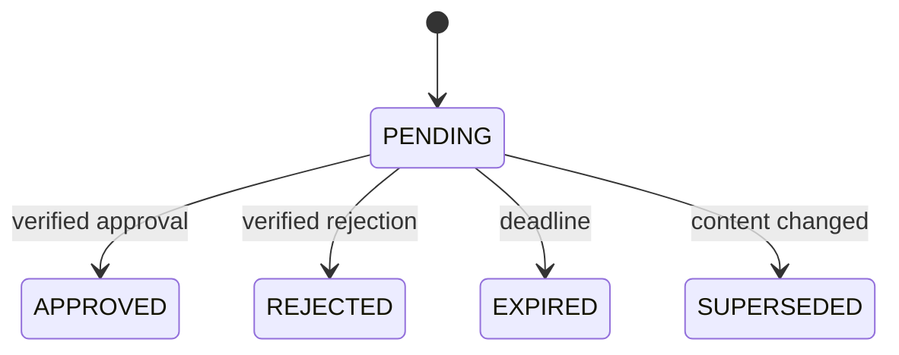

# 授權 決策與不可變批准

版本：2026-11-22，新增 SD 設計。沿用 [SA v1.0](../sa/sa-v1.0.md) BR-01/02/05/07/09/10、03.1、08.2 的權限要求及 SA-AT-013/039/045/051/057/064；補足[第一批工程報告](../research/2026-11-21-engineering-batch1.md)的批准、撤回與內容 hash 缺口。此處是內部契約，沒有宣稱外部商家已核准任何政策。

## 1. 三種依據與兩種人類決策

一個交易通常同時需要客戶對具體條件的同意、商家已生效政策或本次批准，以及外部系統的實際操作權。三者各自保存；不能用其中一種代替另兩種。

| 物件 | 用途 | 能否跨工作重用 |
|---|---|---|
| AuthorityGrant／PolicyVersion | 預先允許哪些角色在什麼條件內執行 | 可服務多個符合條件的 Work，但每次重新核對 |
| CustomerConsent | 客戶對當次 quote、改期、退款方案等具體內容的同意 | 只能在原 target/hash/revision/用途內接續 |
| DecisionRequest | 提供給商家或客戶的具體待決事項、選項、影響與有效期限 | 不能用舊 revision 核准新內容 |
| ApprovalRecord | 已驗證決策者對一份內容的不可變批准證據 | 僅允許原 target 與 manifest 的 root 操作重試/子項續作 |
| ExecutionAuthorization | 執行閘門組合 principal、grant/consent/approval、target 與限制後的授權快照 | 綁定一個 root 業務操作 |
| AuthorizationUse | 將 execution authorization 消耗到唯一 root ExecutionTask | 同一根操作可以找回，不可另建第二根操作 |
| ApprovalRevocation | 撤回指定批准對後續新動作的效力 | 只追加，不改批准當時的歷史 |

模型可以提出決策草案；只有受信任的 UI 確認端點或語音確認服務可以產生有效 Consent/Approval。LLM 工具清單不提供自行簽發批准的能力。既有政策足夠時由後端發出 ExecutionAuthorization，不重複要求負責人點同意。

## 2. 實體與不可變約束

全部實體及外鍵遵守 `(tenant_id, id)`；actor、case、work、decision、policy、root task 必須同租戶。渠道 actor 還需有效 agreement 及欄位/用途投影，不能取得 tenant 全域存取。

| Entity | 欄位與資料規則 |
|---|---|
| DecisionRequest | work_id、decision_type、revision、status、context_refs、options、selected option schema、impact_summary、target_revision、expires_at、requested_role；舊 revision 的展示內容只追加保存 |
| ApprovalRecord | decision_id、reviewed_revision、approved_by、verified_actor_ref、approved_payload、canonicalization_version、payload_hash、policy_version、scope_manifest、approved_at、expires_at、confirmation_evidence；不可 UPDATE/DELETE |
| CustomerConsent | case_id、subject、target_type/id、target_revision、target_hash、purpose、confirmation_nonce_id、evidence_ref、issued_at、expires_at；不可變 |
| ExecutionAuthorization | work_id、root_business_key、capabilities、resource_refs、grant_refs、consent_refs、approval_refs、policy_versions、manifest_hash、expiry、issued_at；不可變 |
| AuthorizationUse | authorization_id、root_task_id、root_business_key、request_hash、used_at；每 authorization 唯一，綁定後不換 task |
| ApprovalRevocation | approval_id、revoked_by、reason、effective_at、created_at；每次撤回附其身分與權限證據 |
| GrantRevocation | grant_id/version、範圍、理由、發出者、時間；影響新執行，不刪過去使用紀錄 |

`UNIQUE(tenant_id, decision_id, reviewed_revision)` 防同一決策版被核准兩次；Decision 的新版要有新的 revision 與 hash，原批准不可移植。一次批准可以有多個明列 manifest item；不能以「批准過這個服務」推定可任意增加渠道、改價格或新增金融動作。

`revoked_at` 如需提供給前端，是從 ApprovalRevocation 計算的 read model 欄位，不放在需更新的 ApprovalRecord。撤回同一批准的重送命令回相同撤回紀錄；再次授權建立新決策/新批准，不刪舊撤回。

## 3. 決策內容 hash

### 3.1 必須包含的內容

批准 payload 至少包含：schema 與 canonicalization 版本、tenant、purpose、target type/ID/base revision、Work/root business key、操作、金額與幣別（適用時）、受益人或商品、service/policy version、有效期間、資料用途、費用負擔者（適用時）、具體 manifest items、使用素材及權利版本、客戶影響與必需 consent refs。

商家看到的卡片由這份 payload 產生，不能以省略重要欄位的摘要另外計算 hash。UI 應展開可核准的實際內容，並提供完整差異；技術 trace ID 與可變排程時間不放入商業 payload。加入、移除或改變任何商業欄位，都形成新 revision/hash。

金額使用整數最小單位；JSON 中以十進位整數字串承載，避免大型整數跨語言精度流失。貨幣精度來自版本化 currency/connector 設定，不固定為兩位。比例以具名分子/分母或明確小數字串表示，禁止 float。

### 3.2 Canonical payload v1

本次定義平台自己的 `canonicalization_version = travel-canonical-json-v1`，正式實作必須提供跨語言測試向量：

1. 依具名 schema 建立物件，拒絕未知欄位、重複 JSON key、NaN、Infinity、未配對 surrogate 與非法數字。必填欄位不得以省略/null 互換；schema 明定選用 null 與缺省值的意義。
2. ID、貨幣碼、時間等欄位先經 schema 驗證成規範格式。UTC timestamp 使用固定表示格式；服務時間仍包含 IANA timezone 與當地日期。展示與 hash 使用同一份規範值。
3. 一般文字保持使用者確認的 Unicode 內容，不默默 trim、折疊空白或翻譯。物件 key 為 schema 定義的 ASCII 名稱，以 byte 升冪排序。陣列保留語意順序；manifest 是有明確 item_id 的清單，產生 payload 前按 item_id 排序一次，之後以該清單展示/確認。
4. JSON 不加格式空白；字串只把雙引號、反斜線及 U+0000–U+001F 作標準化 escape，控制字元固定用小寫 `\u00xx`；不跳脫 `/`，其他合法 Unicode 用 UTF-8。布林與 null 使用小寫。schema 允許的普通整數無前置零；商業金額依前項使用字串。
5. 雜湊輸入為 UTF-8 的固定前綴 `travel-approval-v1\n` 加 canonical JSON bytes；此處 `\n` 表示單一 LF 位元組（0x0A），不是反斜線與字母 n。計算 SHA-256，以小寫 hex 儲存。簽發與驗證必須使用相同 canonicalization_version。

hash 用來綁內容，**不是身分驗證或簽章的替代品**。後端仍驗 session、角色、nonce、有效期、資源版本與當前權限。若 nonce 綁定的展示 hash 與請求不同，回 `AUTHORIZATION_STALE`，不可對未展示版本自動批准。

最低測試向量包括：object key 不同排列仍相同、陣列順序變動不同、金額變動不同、空值與缺省依 schema、不一致 Unicode 表示不得默默碰撞、同金額不同幣別不同、不同 tenant/target 不同、超出 JavaScript 安全整數仍不失真。具體 fixture 與 expected hash 要由單一正式實作產生並在第二語言交叉驗證，不在文件手寫未驗證 hash。

## 4. 決策生命週期與命令

DecisionRequest 狀態為 `PENDING, APPROVED, REJECTED, EXPIRED, SUPERSEDED`。原請求批准後仍保留 APPROVED；是否仍可使用由批准/政策撤回與有效期 projection 判定，不能改寫批准歷史。

所有 mutation 需 Idempotency-Key。對既有內容的核准/拒絕/撤回需 `expected_revision`；支援 If-Match 的入口將 ETag 對應同一 revision，若兩者同時存在且不一致則拒絕，不能挑一個使用。

| 命令 | 成功結果 | 主要拒絕情況 |
|---|---|---|
| 建立決策 | 201 decision ID/revision/hash/display payload | 權限不足、上下文跨租戶、選項不符合 schema |
| 核准決策 | 201 approval ID/hash；同鍵重放回原結果 | 舊版、過期、錯角色、nonce不符、內容變動、政策/素材權利失效 |
| 拒絕決策 | 記拒絕理由、保留 Work 下一步 | 已被不同有效命令解決，回 conflict |
| 提案改版 | 新 revision，舊 pending 版 SUPERSEDED | 舊 expected_revision，回 VERSION_CONFLICT |
| 撤回批准 | 201 revocation record + 受影響未送動作摘要 | 無撤回權、其他 tenant；不能承諾已送出的動作已撤銷 |

具體 API 使用 `POST /v1/decisions/{id}/approve`、`/reject`、`POST /v1/approvals/{id}/revocations` 作本次新增候選；原 SA 的 quote confirmations／proposal approve／remedy confirmations 保留業務入口，內部共用此機制，不能同時產生兩份互不相認的授權。

## 5. 授權使用與父子 manifest

一個 Work 的 root task 先固定 business key 與完整 manifest。ExecutionAuthorization 只可建立一次 AuthorizationUse，消耗到該 root task。相同請求重送應找到同 use，不能回「已使用」後另發一份可用授權繞過。

每個子 task 保存 manifest item ID；執行前核對 operation、resource、version、channel/account、amount/currency、用途及有效期均在該 item 內。原批准 A/B 渠道不允許建立 C 渠道。group root 不直接寫入外部，因此不會與子 task 各執行一次。

事前政策屬 reusable grant；每次 Work 派生獨立 ExecutionAuthorization 並核對政策限制及當期預算。不得對政策本身做一次消耗後令其他合格案件全部停止，也不能免除單案/期間保留。

## 6. 批准與執行的競態

### 執行前

在短 DB transaction 內比對 Work/task/resource revision、Case owner_revision、grant/approval 有效性及 scope，建立授權使用與必要保留，記 dispatch intent/outbox。worker 發出前持有效 lease/fence，再確認沒有已生效的撤回及目標版衝突。

核准不是永遠豁免後續權限檢查。人員被撤除角色、合作用途被撤回或素材權利失效時，未發出的新動作必須停止。政策縮小範圍或改版預設要求重新驗證；需要保留先前承諾的例外應由明確的政策相容規則管理，不能由模型自行認為「差不多」。

### 已送出或可能已送出

撤回與 dispatch 需在同一授權/根操作鎖上有明確排序。撤回先成立且尚未 dispatch，取消未送項目；dispatch 先成立，撤回只阻止後續新動作，既有動作進核對。外部取消若可做，另建有權限的 cancellation/compensation 操作，不把本地撤回當外部成功。

已合法送出的操作要保留只足以核對原結果的 reconciliation context。它不允許新增金額、換受益人或改訂單；外部憑證真的被撤回時記權限缺失並指派責任人，不能假造查核成功或越過帳號控制。

### 金額與預算

批准金額只是可執行上限之一，還要核對已收款餘額、政策期間額度與已有補救。原子鎖定/保留見[金額規格](credit-and-refund.md)。UNKNOWN 不因批准撤回而 release；正式確定沒有生效才可釋放。

## 7. UI 與稽核

決策卡需顯示：要做的事、會改什麼、原因與來源、影響對象、金額/幣別及負擔者、渠道清單、有效期間、可選方案與確認內容。一般使用者不需看到 hash 或 SQL；「內容已更新，請確認這一版差異」要連回新卡片。

稽核保存決策展示版、確認身份與方法、nonce、批准 payload hash、使用到哪個 root task、每個子項、撤回與競態結果。敏感原件用加密物件參考及存取政策，log 不包含 cookie/API key。拒絕事件同樣記錄 purpose 與原因，但回應不能暴露其他租戶資源存在。

## 8. 負向驗收

| ID | Given／When | 必須結果 | 追溯 |
|---|---|---|---|
| SD-A-01 | 模型傳 accepted=true／approval_id 自造字串 | 不簽發、不執行；只接受可信確認流程產出的紀錄 | BR-05 |
| SD-A-02 | 卡片展示版 A，核准前價格/渠道變 B | 回 stale/conflict，重新展示差異；A 不套 B | AT-013/039 |
| SD-A-03 | 同 key 同 payload 重送核准 | 回相同 approval，不重消耗、不中斷有效接續 | BR-06 |
| SD-A-04 | 同 key 改 amount 或 tenant | 409／未授權，無新批准 | AT-045 |
| SD-A-05 | 批准 A/B，子 task 加 C 或換受益人 | AUTHORIZATION_SCOPE_MISMATCH，無外部動作 | AT-051 |
| SD-A-06 | 同一次性 authorization 建另一個 root | 拒絕；原 root 重試仍能查回使用紀錄 | AT-051 |
| SD-A-07 | revoke 與 dispatch 同時執行 | 可解釋且有紀錄的先後；已送出進核對，不宣稱取消成功 | SM-01 |
| SD-A-08 | 已批准後 actor 權限/素材權利被撤回 | 未發出動作停止；已發出保留證據並處理撤回後續 | AT-052/057 |
| SD-A-09 | 兩種序列化語言對同 payload 算 hash | 測試向量一致；不一致阻擋部署該確認入口 | 本次新增 |
| SD-A-10 | grant 可重用，兩筆標準服務符合政策 | 分別核對與授權，不要求老闆逐案批准 | AT-064 |
| SD-A-11 | 過期 break-glass 存取原始音訊 | 拒絕與稽核；不能因先前批准過永久保留讀權 | AT-057 |
| SD-A-12 | 退款 UNKNOWN 後批准撤回 | 保留 refund/policy reservation，核對原退款；不發新退款 | AT-032/047 |

## 9. 後續實作

補 authorization/consent/decision schema、append-only triggers、有效性 read model、canonical encoder fixture、nonce/語音確認入口、policy evaluator、授權使用原子 transaction、角色撤回事件與 integration tests。原報告 immutable Approval 片段不可直接部署成允許修改 revoked_at 的表；原 SA authorizations 的 consumed_task 需與同一 AuthorizationUse 投影一致。
