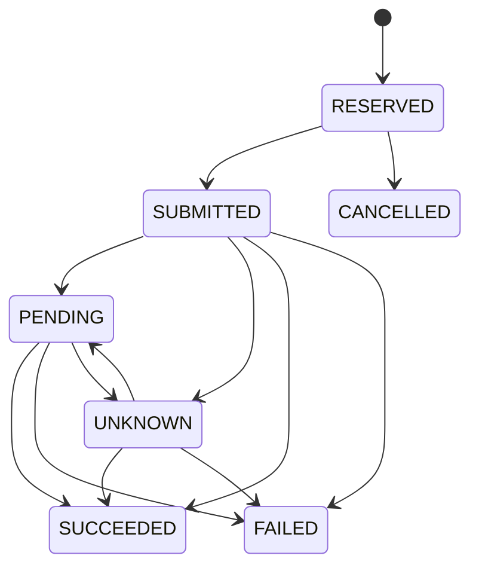

# Credit 與退款執行規格

版本：2026-11-22，新增 SD 設計。以 [SA v1.0](../sa/sa-v1.0.md) FR-09/13/14/15/27、UC-05/06、BR-16/17、08.1、SA-AT-010/018/031/032/033/047/048/063 為基線；[第一批報告](../research/2026-11-21-engineering-batch1.md)的 NT$500 Credit 僅是原型例子。本文件沒有核定任何商家額度、費率、分潤、預算或兌換期限。

## 1. 業務分離

| 物件／動作 | 意義 | 成功所需來源 |
|---|---|---|
| Refund | 對原付款進行退款；由有權的原收款主體處理 | 指定 PSP／原付款系統的正式退款結果 |
| CreditGrant | 商家按已批准條款給指定受益人的服務抵用額度 | 指定 Credit 系統的唯一發放紀錄及有效狀態 |
| RemedyAction | 已選定並授權的一項補救，例如改期、退款、Credit | 對應動作及其完成證據 |
| Complaint | 客訴事實、期待、補救與未解爭議 | 所有必要補救結果及有理由的結案判定 |
| Case | 接單或營運案件與接續責任 | 不能與 Complaint 或單一退款等同 |

Credit 不表示現金已退回，也不自動減少原付款可退餘額。是否可同時退款、Credit 是否抵扣補救上限、過期規則與誰負擔，由版本化政策明列。沒有這些條款時只能做草案與索取決策，不能自動發放。

標準退款不必硬建成客訴；從原訂單的 change/remedy preview 啟動即可。客戶尚未驗證可描述問題及建立 Complaint；讀私人訂單及執行金額操作前完成目的綁定的驗證。

## 2. 共用金額與身分契約

- DB 使用整數最小貨幣單位；HTTP/JSON 金額使用十進位整數字串並包含 currency。貨幣精度依明確版本設定；不得把所有幣別當兩位小數。
- 金額大於零、不得跨幣別直接相加；外部金流要求整數元或其他格式時，adapter 依已測試產品版本轉換。不能以浮點四捨五入消除差額。
- 所有 parent/child/beneficiary/payment/policy/approval 關聯包含 tenant_id。channel 只看本合作允許的資料。
- payment 的 `collector_account`、environment、currency、原外部交易 ID 不可由模型自由改寫。渠道收款不得由平台另退一筆。
- 金額操作引用原 OrderSnapshot、RemedyPreview hash、customer consent（需要時）、policy version 與特定 root task。現在商品頁的條款不改舊訂單。
- 用途、受益人、幣別、金額或條款變動須新 preview/批准；不能在已核准 request 內直接 patch。

## 3. 實體與唯一限制

| Entity | 必要欄位／約束 |
|---|---|
| RemedyPreview | order/complaint/case refs、原 order revision、原付款、policy version、eligible actions、金額/幣別、受益人、負擔者、影響、source balance evidence、expiry、payload_hash；不可變 |
| RemedyAction | preview_id、selected_item_id、work_id、root_task_id、business_key、status、authorization_ref、customer_consent_ref；同一次選定補救唯一 |
| Refund | payment_id、remedy_action_id、amount_minor、currency、collector_account、provider_refund_id、operation_key、state、source_revision、evidence；業務鍵唯一 |
| RefundReservation | refund_id、payment_id、amount、state(HELD/CONSUMED/RELEASED)、source_balance_version；只由正式 transition 轉移，歷史另留不可變 event |
| PolicyBudgetReservation | policy/version、scope/period/currency、root task、amount、state；與 RefundReservation 分開核對 |
| CreditAccount | tenant、issuer、beneficiary、currency、revision；只表示額度帳戶，不推定現金代管 |
| CreditGrant | account_id、remedy_action_id、grant_operation_key、issued_amount、terms_version、scope、valid_from/expires_at、provider_grant_id、state、evidence |
| CreditLedgerEntry | account/grant、entry_type、amount、business key、source operation、reversal_of、occurred_at；不可變，原始 entry 不刪改 |
| CreditUsageReservation | grant/account、order、redeem_operation_key、amount、state；防兩個 checkout 同時超用 |
| SettlementEntry | 原交易/退款/渠道/契約版、amount/currency、basis、reversal_of；沖回引用原 entry 並有唯一業務鍵 |

`UNIQUE(tenant_id, operation, business_key)` 先防換 API key 重複執行。`UNIQUE(tenant_id, connector_account_id, environment, provider_refund_id)` 防不同來源重複匯入同一外部退款；Credit grant 同理。

同一問題跨電話/LINE 進來，以驗證後的 Case/Complaint/Order 映射續接，不能只靠姓名或語意相似自動合併。無法確定是否重複補救時保持受理與查核，不直接新發金額。一次核准補救的每個 selected_item 有穩定 ID，重送不得另外生成新的 RemedyAction。

## 4. 退款生命週期

退款 domain 狀態為 `RESERVED, SUBMITTED, PENDING, UNKNOWN, SUCCEEDED, FAILED, CANCELLED`。draft/試算留在 RemedyPreview，未通過授權與原子保留前不建立假正式退款。

| 狀態 | 餘額與預算 | 使用者看到的意義 |
|---|---|---|
| RESERVED | 原子保留退款上限及適用預算 | 已接受處理，尚未送出原收款系統 |
| SUBMITTED | 保留持續 | 已送出，正在取得正式結果 |
| PENDING | 保留持續 | 原付款系統明確處理中 |
| UNKNOWN | 保留持續，不得另退 | 結果核對中，原操作可能已成功 |
| SUCCEEDED | refund 保留轉已退、預算保留轉 spent | 以 provider 正式成功狀態與時間回報 |
| FAILED | 只有證實無副作用才 release | 明確失敗，列出後續方式與責任 |
| CANCELLED | 僅未送出且可證明沒有副作用時 release | 本次未送退款已取消；不代表原訂單也取消 |

晚到的成功事件不應直接覆寫 FAILED。若先前宣告 FAILED 的證據被新的 provider 事實推翻，進 incident/reconciliation，立即核對餘額及後續已發操作；保存矛盾歷史，不刪失敗證據。這也是為何「timeout→FAILED」不可使用。

## 5. 可退款餘額與原子保留

### 5.1 計算基礎

以同 tenant/payment/currency 的已核對資料計算：

`平台可用退款額 = 已核對原收款額 − 已成功退款總額 − RESERVED/SUBMITTED/PENDING/UNKNOWN 的未決保留額`。

外部原有退款必須先透過唯一 provider mapping 匯入或核對，不能把一筆已成功退款同時當「外部已退」與「本地 UNKNOWN 保留」重複扣兩次。來源提供的可退餘額若更小，採較保守的可執行額並調查差異。

不能假定平台 DB 鎖可以阻止商家在 PSP 後台另外退款。adapter 必須實測 provider 對退款上限的行為、讀回與冪等能力；外部併發無法判定或餘額不可查時停止該筆自動金額操作，建立指定人核對，必要服務與客訴處理繼續。

政策預算是第二個獨立限制：`reserved + spent + 本次額度 <= policy limit`，同幣別、同適用期間/範圍分組。退款可用額與政策額度都要通過。政策上限是 AI 可自行操作範圍，不是對客戶應有處理的結論。

### 5.2 短 transaction

本文件的全域鎖順序為：根授權使用/業務鍵 → payments（按 ID 排序）→ credit accounts（按 ID 排序）→ policy budget buckets（按 ID 排序）。各模組沿用，不以相反次序鎖相同集合。只用到其中幾類就跳過其他類。

1. 以業務鍵取得或建立同一 root task；同 key 同 payload 回原操作，同 key 不同 payload 拒絕。
2. 鎖定必要資料列，檢查 tenant、actor/authority、order revision、preview hash/expiry、customer consent、原收款主體與 source freshness。
3. 核對退款餘額與政策 budget；建立唯一 Refund/Reservation，綁定 AuthorizationUse；寫 task/outbox。
4. commit 後才呼叫 PSP，不能持 payment row lock 等待網路。
5. provider 結果經驗證後在新 transaction 以 expected revision/idempotent event 轉移 reservation；同步寫結果/outbox/需要的結算沖回。

兩個不同 Case 同時退同一付款，第二筆只能看到第一筆已保留後的餘額。UNKNOWN 保留不過期自動刪除。正式無副作用證據才允許 release；人工如需解保留也必須附可核對結果與適當權限。

## 6. Credit 最低可用設計

### 6.1 啟用前必填條款

需要 issuer、beneficiary、amount/currency、可用商品/據點/渠道、是否可轉讓、是否可部分使用、合併使用規則、有效期間、取消訂單後的回補方式、撤回條件、與退款/其他補救的累計關係及成本負擔者。這些不是預設業務答案；未核准欄位保持缺口並顯示需要誰決定。

NT$500 Credit 可作示範卡片的 example data；不能進 seed 成為所有商家的預設批准或自動補償門檻。production tenant 啟用前需自己的 policy/terms version。

### 6.2 發放與台帳

CreditGrant 發放遵循與退款相同的 Work/Authorization/ExecutionResult。發放請求明確 pending 用 PENDING；可能已發但回覆不明用 UNKNOWN。若由平台自己的 Credit ledger 管理，發放與唯一業務鍵同一 transaction 完成，可直接產生正式 ISSUE evidence；若外部商家系統管理，只保存 projection，不能在本地先創可用額度再等外部結果。

台帳 entry type 為 `ISSUE, REDEEM, REDEEM_REVERSAL, EXPIRE, REVOKE`，amount 為正數且依 type 定義方向。餘額 projection：ISSUE 與有效 REDEEM_REVERSAL 增加；REDEEM、EXPIRE、REVOKE 減少。usage reservation 另扣可用額；每筆 reservation 只能轉 consumed 或 released 一次。

`可用額 = 台帳有效餘額 − HELD 的使用保留額`。兩個 checkout 同時使用同一 grant 時鎖 account/grant 並比對 revision，禁止可用額為負。外部 redemption pending/unknown 的使用保留持續存在。

所有 reversal 必須引用原 REDEEM，累計不得超原扣額；重送取消事件只產生一次 reversal。EXPIRE/REVOKE 只作用於可收回餘額，不能與已保留使用重複扣減；發生競態時先核對 pending/unknown 的真實使用結果，再按已核准條款處理。

### 6.3 狀態維度

Credit 發放操作狀態與帳戶可用狀態分開。Grant 可用狀態如 ACTIVE、EXHAUSTED、EXPIRED、REVOKED 是 ledger/條款 projection，不能拿來代替發放 ExecutionTask 的 UNKNOWN/PENDING。原批准撤回只阻止尚未發放項；已發額度的撤回是獨立有權限且具條款依據的 REVOKE 操作。

退款不自動把曾用 Credit 換成現金。訂單可能有現金付款與 Credit 使用兩種組成，取消 preview 分別列出現金原路退款與 Credit 回補，客戶同意綁兩項，兩個子 ACTION 各自核對結果。若其中一項成功另一項等待，Work 為 PARTIAL／等待，不能說全部退款完成。

## 7. 批准內容與證據

RemedyPreview/Approval hash 包含原付款、原訂單版本、各 action 類型與 amount/currency、beneficiary、policy/terms version、collector/issuer、必要客戶同意、費用負擔與 manifest。外部 connector selection 不能把原收款主體換成平台帳戶。

| 完成物件 | 必要 evidence |
|---|---|
| Refund | provider account/environment、原 payment ID、refund ID、amount/currency、正式終態、source revision/查詢時間與 payload hash |
| CreditGrant | issuer/account/environment、grant ID、beneficiary、amount/currency、terms version、有效可用狀態與正式記錄 |
| Credit redeem/reversal | 原 grant、order、唯一 redeem/reversal ID、金額、台帳前後 revision、正式結果 |
| Policy budget | reservation ID、使用 root task、轉 spent/release 依據；不是只有前端顯示剩餘額 |
| Settlement reversal | 原 settlement entry、refund reference、原 contract version、basis 與調整額；不改原紀錄 |

通知只是後續 Work；通知失敗不再退款或重發 Credit。客訴結案另外核對必要補救、通知/接續、未解爭議及理由，不能以 Credit issued 自動標客戶滿意。客戶無回覆也不代表滿意。

## 8. 部分退款與合作結算

佣金與服務對價依原成交契約版及清楚的計算 basis 處理。部分退款不重算成目前商業規則；新增 `SettlementEntry` 沖回原 entry，保存 `reversal_of`，重複 refund event 不重複沖回。

平台收入、客戶實付、供應應付、渠道應付與費用負擔分欄；不將 GMV 當收入。Credit 的費用負擔及是否影響特定報酬需原政策/合約明列，沒有就列待確認，不能套用任意費率。此子帳支援合作對帳，不代表已建立法定總帳。

## 9. 異常接續

| 異常 | 系統動作 |
|---|---|
| 退款接口無權／餘額無法查 | 保留案件，建有責任人的查核；不從另一帳號代退 |
| 退款成功、訂單取消失敗 | 分列狀態，開例外 Work；不為修補取消再退一次 |
| 訂單取消成功、退款 PENDING | 明示退款處理中與追蹤期限；Complaint 不自動解決 |
| Credit 發放回覆遺失 | UNKNOWN，以原 grant key 查回；不用新 key 重發 |
| 外部人工退款較本地先發生 | 匯入/映射並重新算餘額；原保留與外部成功不可重複計算 |
| 額度不足但必要售後未完成 | 升級有權責的人，不拒絕受理或因 AI 額度關案 |
| 全部金額操作完成、通知失敗 | 只重送通知或提供指定跟催，不回退金額結果 |

## 10. 負向驗收

| ID | Given／When | 必須結果 | SA追溯 |
|---|---|---|---|
| SD-M-01 | 同 payment 兩不同 Case 同時申請合計超額退款 | 固定鎖順序；只接受可用總額，不能超退 | AT-047 |
| SD-M-02 | 第一退款 UNKNOWN，第二案再次退款 | 第一保留仍計入餘額；不當它失敗釋放 | AT-032/047 |
| SD-M-03 | 同政策期間兩案競爭預算，其中一案 timeout | reserved+spent 不超上限，timeout仍占用 | AT-048 |
| SD-M-04 | 同 remedy 用不同 API key 重送 | 找回同 action/refund/grant，不重補 | AT-033/051 |
| SD-M-05 | 渠道收款、模型嘗試用平台 PSP 退款 | collector scope 不符，拒絕；交原有權者接續 | BR-16 |
| SD-M-06 | 同 provider refund 從 webhook 與輪詢到達 | 一份成功、一次 budget轉換、一次結算沖回 | AT-018/049 |
| SD-M-07 | 兩種不同貨幣精度及大整數金額 | 正確最小單位、無浮點誤差、不跨幣別相加 | AT-063 |
| SD-M-08 | 同 Credit grant 兩 checkout 同時使用超餘額 | 一致的原子 usage reservation；不可負餘額 | 本次新增 |
| SD-M-09 | Credit redeem UNKNOWN 後 grant 到期 | 保留使用占用並核對；不能同時EXPIRE及完成同額REDEEM | 本次新增 |
| SD-M-10 | 重送退款/取消事件要求Credit回補 | reversal唯一且累計不超原redeem；不重發 | 本次新增 |
| SD-M-11 | 退款成功、通知失敗或客訴仍有爭議 | 不重退；Complaint獨立追蹤，不假結案 | AT-010/021 |
| SD-M-12 | preview後訂單版/金額/期限改變 | 舊同意失效，重試算與必要確認 | AT-004/013 |
| SD-M-13 | 外部退款存在但本地尚未匯入 | 查回對應後再算餘額；不重退、不重複扣除同退款 | BR-17 |
| SD-M-14 | 批准撤回與退款送出競態 | 未送出可取消；已送出核對，UNKNOWN不release | SM-01 |
| SD-M-15 | production tenant沒有Credit條款，UI示範500被送出 | 拒絕自動發放，要求補實際政策；不把example當授權 | 本次新增 |
| SD-M-16 | 原政策改版後處理舊單部分退款 | 依原成交/適用政策與原結算規則，不改舊snapshot | BR-10 |

## 11. 後續實作與未定項

需補實際 PostgreSQL migration、原子函式/transaction、並行及 worker kill 測試、PSP/credit adapter、ledger projection、對帳與例外 UI。SA 曾引用 `02_atomic_refund.sql`，目前不能因主文描述而認定該檔已找回或實機測過。

待具體商家配置的項目包括：政策與預算、Credit issuer/條款、收款與退款主體、provider account/environment/產品版本、source freshness/lookup條件、責任人與回應期限。這些缺少時仍可開發共用核心、mock與驗收；正式自動金額能力保持未啟用。
