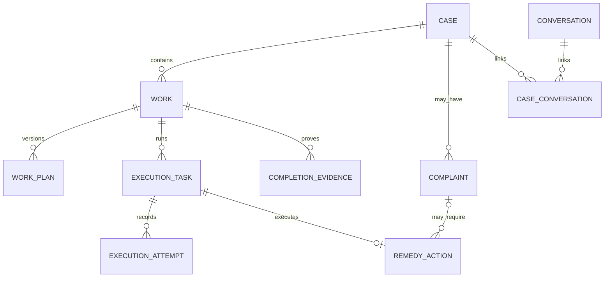
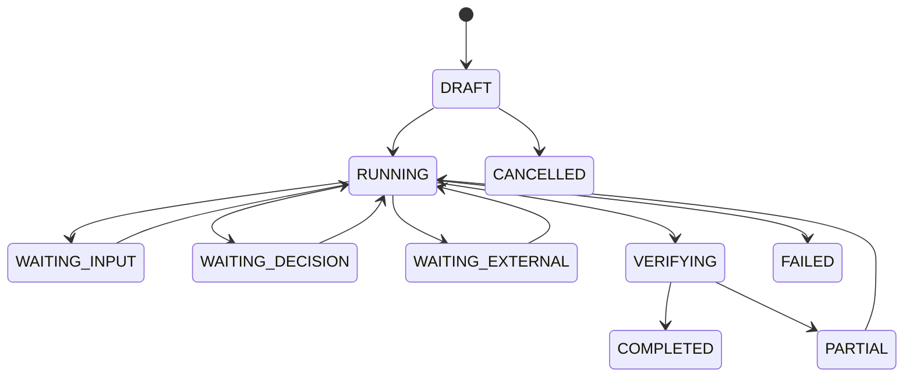

# Case Work 與 Execution 契約

版本：2026-11-22，新增 SD 設計。來源為 [SA v1.0](../sa/sa-v1.0.md) FR-03、FR-25、03、08、SA-AT-046/051/056，以及[重建報告](../research/2026-11-20-rebuilt-sasd.md)與[第一批報告](../research/2026-11-21-engineering-batch1.md)。本文件統一語意，不宣稱已還原或執行舊 migration。

## 1. 領域責任與關聯

| 物件 | 保存內容 | 不能代替的物件 |
|---|---|---|
| Case | 接單或營運案件、需求版、溝通關聯、負責人、下一步與等待期限 | 不是每次 API 呼叫，也不限客訴 |
| Conversation | 通道與訊息；可跨多次接觸關聯同案 | 對話結束不代表案件或工作完成 |
| Complaint | 期望、陳述、事實、補救與客訴關案理由 | Remedy 成功不自動關案 |
| Work | 一個受理的業務目標、計畫、完成契約、完成證據與接續責任 | 不以 workflow run 當主鍵 |
| ExecutionTask | 一個穩定 operation/business key、權限與前置條件、排程及核對狀態 | 不隨重試建立第二個業務操作 |
| ExecutionAttempt | 一次發出、查詢、讀回或結果處理的不可變紀錄 | timeout attempt 不能直接代表整個操作失敗 |
| Order／Quote／Payment | 各自交易事實與版本化快照 | Work summary 不得覆寫交易事實 |

一般商家及旅客 Work 必須有一個 primary `case_id`。同案可有查價接單、改期、通知、素材取得、商品改版等多個 Work；跨案關聯用有權限的 typed reference，不複製或隱式合併案件。平台維護工作不在本輪商家 Work 的枚舉內，需要另案設計時登記需求。

Case 與 Complaint 的既有 API、存取控制和需求版保留。`execution_id` 對應 ExecutionTask；SA `/tasks/{id}` 繼續查這個物件。新增 `/works/{id}` 查業務目標與彙整進度，不能把這兩個端點回傳成同一份無型別 JSON。

RemedyAction 的 `complaint_id` 可為空；標準取消、改期及退款可直接關聯原 Case／Order，不需建立客訴。涉及客訴的補救才連到 Complaint，且動作完成與客訴結案分開判定。

## 2. 最低資料契約

全部業務表以 `(tenant_id, id)` 為主鍵或唯一鍵；每個 parent、child、actor、order、policy、approval、asset、connector 外鍵包含 tenant_id。以下是設計欄位，不是可直接部署的 DDL。

| Entity | 必填欄位與約束 |
|---|---|
| Work | case_id、work_type、objective、completion_contract_version、completion_conditions、principal、authority_context、status、revision、created_at；完成條件須通過具名 schema |
| WorkPlan | work_id、plan_revision、steps、dependencies、planner_version、context_refs；`(tenant_id,work_id,plan_revision)` 唯一，只追加 |
| WorkContext | work_id、ref_kind、typed target ID、target_revision、purpose；核心 order/quote/service 的 reference 有實體 FK，不能只存自由字串 |
| ExecutionTask | work_id、kind(ACTION/GROUP)、parent_task_id、operation、business_key、request_hash、request_snapshot、status、revision、postcondition_version、postcondition、authorization_use_id、owner_revision、next_run_at、deadline、fence_token |
| ExecutionAttempt | task_id、attempt_no、attempt_kind(DISPATCH/RECONCILE/VERIFY)、fence_token、request_hash、started_at、request_ref；發出時寫入後不可變 |
| ExecutionAttemptObservation | attempt_id、sequence、observed_at、transport_result、external_ref、evidence_ref、outcome；timeout與晚到結果各追加紀錄，不覆寫原始嘗試 |
| TaskLease | task_id、holder、fence_token、leased_until；fence 單調增加，不能重用過期值 |
| WorkEvent | work_id、sequence、event_type、schema_version、causation_id、correlation_id、resource_revision、occurred_at；sequence 唯一，只追加 |
| CompletionEvidence | work_id、task_id、evidence_type、source_account、environment、external_ref、source_revision、observed_at、verified_at、payload_ref、payload_hash、verifier_version；不可變 |
| Escalation | work_id/task_id、reason、owner、due_at、status、resolution_ref；與執行狀態獨立 |

`business_key` 依 operation 的業務來源導出，例如 `booking:create:quote_id`、`refund:remedy_action_id`、`publication:offer_id:service_version_id:operation`。它不是隨機 UUID 每次重生。資料庫至少有 `UNIQUE(tenant_id, operation, business_key)`。

所有任務的 `request_snapshot` 是通過 schema 的實際業務內容；憑證、cookie 與原始卡資料不得進入 snapshot。可變的 runtime timeout 不可悄悄改動已批准商業內容。tenant 由可信 session／service principal 導出，忽略模型任意傳入的其他 tenant。

`parent_task_id` 必須同租戶、同 Work；父子圖不得成環。GROUP 不直接呼叫外部寫入；子 ACTION 的 scope 必須是父 manifest 已列項目。一般 ACTION 不可有 PARTIAL 終態，複合業務需要明列子 ACTION。

## 3. Work 業務狀態

本次採用：`DRAFT, RUNNING, WAITING_INPUT, WAITING_DECISION, WAITING_EXTERNAL, VERIFYING, PARTIAL, COMPLETED, FAILED, CANCELLED`。

| 轉移 | 必要條件 | 需要持久化的結果 |
|---|---|---|
| DRAFT → RUNNING | objective、principal、完成條件及必要存取範圍可成立 | 接受責任事件、plan revision |
| RUNNING → WAITING_INPUT | 缺少能由特定人提供的必要資訊 | missing_fields、requested_from、due_at；只問缺項 |
| RUNNING → WAITING_DECISION | 超出事前授權或需新承諾 | DecisionRequest、具體版本與選項 |
| RUNNING → WAITING_EXTERNAL | 外部已知 PENDING 或動作 UNKNOWN | task refs、waiting_reason、next_check_at、責任人 |
| WAITING_* → RUNNING | 有可信輸入或事件 | 重新驗證原版本、授權與需求；不直接跳進寫入 |
| RUNNING／WAITING_EXTERNAL → VERIFYING | 需要的外部動作已有可核對結果 | 逐項 postcondition 與 evidence refs |
| VERIFYING → COMPLETED | 全部必要條件成立，所需證據完整，必要通知已滿足或有契約允許的獨立追蹤 | completion_record，引用契約版、驗證器與證據 |
| RUNNING／VERIFYING → PARTIAL | 至少一個必要子項完成，另有必要項未完成且目前不可繼續 | 每子項結果、未完成原因與接續責任；不表示全部已完成 |
| PARTIAL → RUNNING | 修復條件、版本與授權仍有效 | 只喚醒未完成子項 |
| 未完成 → FAILED | 有明確失敗或不再能達成，沒有未判定的不可逆副作用 | 失敗原因、已產生影響、補償或升級工作 |
| 未送出 → CANCELLED | 無未判定副作用且取消權有效 | 取消原因、釋放可釋放保留 |

Work 可以同時有未解 escalation。UNKNOWN 的 task 不能因處理期限到就把 Work 轉 FAILED/CANCELLED。若人工以範圍縮減完成剩餘責任，必須建立新版 completion contract 與相應批准；不能修改歷史條件令既有失敗變成成功。

圖示只畫主路徑；轉移權限與副作用判定以表格為準。`COMPLETED` 不因晚到舊事件回退。之後發現新問題時追加 evidence/incident，建立新的 Work 或明確 reopen event，不修改原完成證據。

## 4. ExecutionTask 狀態與穩定身分

沿用 SA SM-01 的執行語意：`NEW, VALIDATING, READY, EXECUTING, WAITING, VERIFYING, UNKNOWN, DONE, FAILED, CANCELLED`。`PARTIAL` 只允許 GROUP 聚合；`ESCALATED` 改以獨立 Escalation 表示，保留實際的 WAITING／UNKNOWN 等狀態。

| 轉移 | 執行規則 |
|---|---|
| NEW → VALIDATING | 寫入完整 snapshot/hash；確認 operation 與 capability |
| VALIDATING → READY | 在同一 transaction 核對權限、revision、授權使用、金額/資源保留並寫 outbox |
| READY → EXECUTING | worker 取 lease/fence；短交易建立 dispatch intent；提交後才呼叫外部 |
| EXECUTING → WAITING | 提供者回已識別操作的 PENDING；記 external_ref、waiting_on、next_check_at |
| EXECUTING → UNKNOWN | timeout／斷線／回覆不可解析且請求可能生效；保持 operation key 及保留額度 |
| EXECUTING／WAITING／UNKNOWN → VERIFYING | 可信回覆或查核已得到終態；不可只靠本地推測 |
| VERIFYING → DONE | operation 的 postcondition 及正式 evidence 成立 |
| VERIFYING → FAILED | 正式終態失敗，或有證據確定未執行；release 規則依 domain |
| WAITING → VALIDATING | 等待的新資訊/決策到達；若屬外部已受理 PENDING，僅進核對模式，不重新 dispatch |
| UNKNOWN → UNKNOWN | 還無法判定；退避並可升級，不能生成新副作用 |
| 未 dispatch → CANCELLED | 授權撤回或需求改版，尚未送外部且保留可安全釋放 |

`attempt_kind=RECONCILE` 與 `VERIFY` 只能調已宣告唯讀的能力。提供者的「查詢」若其實會建立/完成交易，必須列為寫入 capability 並走新批准與前置條件，不藏在核對函式。

失敗重試需區分：未送出的可重試 transport failure 可用同 task/key 新 attempt；已送出的 UNKNOWN 先查結果；正式拒絕且需要改參數時建立新版業務請求並重新授權。不得把 `retryable=true` 當授權。

## 5. 新舊名稱與狀態映射

| 舊來源 | 本次語意 |
|---|---|
| SA Case | 保留 Case；接單/營運容器 |
| SA ExecutionTask、`/tasks/{id}` | 保留穩定 ExecutionTask；API execution_id 指向它 |
| 重建報告 Task | Work；保留 principal、objective、completion conditions、authority、plan、escalation、evidence 七項契約 |
| 第一批報告 Work.IN_PROGRESS | Work.RUNNING |
| 第一批報告 Work.UNKNOWN | Work.WAITING_EXTERNAL + waiting_reason=RESULT_UNKNOWN，引用 UNKNOWN task |
| Task.ACCEPTED／PLANNING | Work 的受理/計畫事件與 plan phase，不另外建立 Task 表 |
| 第一批 Execution.PENDING | 尚未送出映射 READY；外部已受理映射 WAITING；不能不看 evidence 直接批次轉換 |
| SA task.ESCALATED | 保留原 lifecycle，加 Escalation；歷史資料先核對，不能遺失 UNKNOWN |
| 第一批 Execution.SUCCEEDED | task.DONE，但必須有符合 postcondition 的 evidence |

若舊資料不能判別 pending 是排隊還是外部受理，標 `migration_review_required` 並保留原值，禁止自動重送。這是未來 migration 的要求，目前沒有宣稱找到或遷移資料。

## 6. 冪等、併發及回覆所有權

### 6.1 兩層去重

API 冪等唯一鍵為 `(tenant_id, actor_id, operation, idempotency_key)`，保存 canonical request hash、原回應及資源 ID。同鍵同內容回同 Work/task；同鍵不同內容回 `409 IDEMPOTENCY_CONFLICT`。業務唯一鍵另以 `(tenant_id, operation, business_key)` 防止客戶更換 key 建第二筆單。

Key 的保留期限不得短於該類業務可重送/對帳期間；具體期限是部署設定，不在本文件填任意天數。即使 API key 快取過期，業務唯一約束仍存在。回傳既有物件前重新驗權；無權讀取者不可藉重放 key 取得結果。

### 6.2 短交易邊界

命令 transaction：鎖/比對目標 revision → 建立或找到 business key → 核對授權使用 → 保留資源/額度 → 寫 task 與 outbox → commit。外部網路在 commit 後，由持有效 lease 的 worker 執行。

外部成功與本地保存之間可能斷線。固定 operation reference 要在呼叫前持久化，接手 worker 以它查回；不得因找不到 response 就重新建立 Booking/Refund。source provider 不提供可靠 key/lookup 時，進人工核對並停用該自動重做路徑。

### 6.3 Lease 與 fence

每次取租約原子增加 fence_token。worker 在寫 dispatch intent、發通知前重新核對 fence、lease、owner_revision 與 target revision。過期 worker 不得建立新外部動作。若它已發出請求，晚到結果可成為核對線索，經來源驗證後追加 evidence，不能直接用舊 fence 覆寫新版狀態。

Case 人工接手原子增加 owner_revision，阻止舊 AI 新回覆及新寫入。已發出的合法操作仍由受控核對流程追蹤；真人不需手動重建交易。通知 Work 失敗只重送通知，不再執行上游付款。

## 7. 完成證據與發布獨立性

| 工作 | 必要 postcondition／evidence |
|---|---|
| 預訂 | 指定帳號與環境的 external booking ID、正式 confirmed 狀態、需求/quote/成交 snapshot 一致、付款條件符合 |
| 退款 | 外部 refund ID、原 payment、金額/幣別、正式終態與查詢時間；取消成功不代替退款 |
| Credit | 已驗證發放系統的唯一 grant ID、受益人、金額/幣別、條款版、可用狀態；僅 UI 勾選不夠 |
| 服務改版 | 基礎版本無衝突、新不可變 service version、批准 payload hash、素材權利有效 |
| 渠道發布 | 每渠道 listing ID、observed version/hash、實際銷售狀態、read-back evidence；只回 200 不夠 |
| 通知 | 依已定契約為 provider accepted 或 delivered；狀態分開保存，不臨時降低條件 |

發布到 A、B、C 是三個 Publication/子 ACTION。A 成功、B 審核中、C 拒絕時，A 保持成功，B 等事件/核對，C 顯示原因與責任。父 Work 可顯示 PARTIAL；重試 C 不重新發布 A，也不自行把 C 從批准 manifest 移除。

## 8. 待實作命令與事件

新增 API 建議：`POST /v1/works`、`GET /v1/works/{id}`、`POST /v1/works/{id}/inputs`、`POST /v1/works/{id}/cancel`。既有 Case、quote、checkout、remedy、publication 命令在內部建立/連結 Work，不要求前端為同一動作另送第二次 Work。

不可提供任意 `PATCH status=COMPLETED`。取消與人工補充 evidence 是受控命令，後端核對條件再轉移。Work 讀取顯示 objective、state/reason、waiting_on、due_at、目前 plan、decisions、子操作與完成證據；通常不向一般商家展示 fence 等內部欄位。

新增事件沿用 SA envelope：`work.accepted`、`work.waiting`、`work.completed`、`work.partial`、`execution.result_unknown`、`execution.verified`。各包含 tenant、producer、event ID、schema version、resource revision、causation/correlation、必要 payload。事件/時間不是唯一真相；晚到事件透過 revision 與來源查核，不將 DONE 倒回 WAITING。

## 9. 負向驗收案例

以下均為待執行規格，沒有宣稱測試已通過。

| ID | Given／When | 必須結果 | SA 追溯 |
|---|---|---|---|
| SD-W-01 | 同 Case 先電話後文字，已驗證為同需求；再次送出購買 | 續接原 Case/Work/業務鍵，只有一筆供應預訂 | FR-02/03、AT-005/033 |
| SD-W-02 | Case 是服務企劃；建立素材與發布 Work | 不強制建 Complaint；案件保留原需求與負責人 | UC-07/08、FR-17/18 |
| SD-W-03 | 甲租戶 task 指向乙 Work／Case／parent_task | API 拒絕且不洩漏存在；直接 DB 寫入亦由複合 FK 拒絕 | AT-045 |
| SD-W-04 | worker A lease 過期，B 接手；A 晚到寫入 | A 不發新副作用；可能已送出的先查回；只存一次結果 | AT-046 |
| SD-W-05 | 模型仍產生回覆時真人接手 | owner_revision 改變；舊回覆不能發出；交易核對持續 | AT-011 |
| SD-W-06 | 上游已預訂，worker 在本地落庫前死掉 | 重啟以固定 reference 找回；不建第二單 | AT-006/056 |
| SD-W-07 | task UNKNOWN 超過 deadline | 保留 UNKNOWN、金額/授權占用，建立有 owner/due 的 escalation | BR-08 |
| SD-W-08 | 一渠道成功、另一路 pending、第三路拒絕 | 分別顯示；父 Work 不說全部完成；重試只作用於失敗項 | AT-015/040 |
| SD-W-09 | 通知失敗但付款與預訂成功 | 只重送通知，原交易與成功證據不回退 | AT-021 |
| SD-W-10 | 前端或模型要求 `status=COMPLETED` 無證據 | 不接受狀態任意修改；verifier 判定失敗 | FR-25 |
| SD-W-11 | 取消與 dispatch 同時競爭 | DB 明確先後；已 dispatch 的追蹤結果，未 dispatch 的不送出 | SM-01 |
| SD-W-12 | 舊 confirmed/pending 事件晚於新終態到達 | 不回退；矛盾事件觸發來源核對，不刪原證據 | AT-022 |

## 10. 仍待工程完成

補正式 schema/migration、狀態 reducer、Case/Work API、外部 adapter、Worker、read model、權限與並行測試。選用 Temporal 時以它承載等待/事件恢復，Case/Work/Execution IDs 仍是業務身分；選型不豁免 outbox、冪等、外部讀回或原子金額保留。
